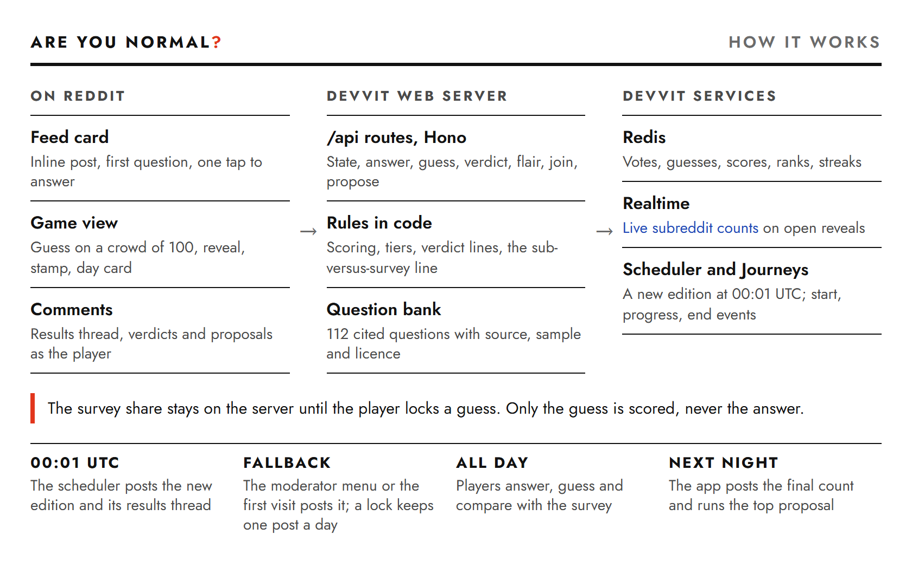

# Are You Normal?

[](https://github.com/Marc-Dvci/are-you-normal/actions/workflows/ci.yaml)


[](LICENSE)
[](https://www.reddit.com/r/AreYouNormalDaily/)

**A daily Reddit game that puts you, your subreddit and a real published survey on the same chart.**

Every day a new post asks three everyday questions. You answer for yourself, guess how many people in 100 answered the same way, and then see the real share from a cited survey next to the live share of players in the subreddit. A rubber stamp gives the verdict: under 5% is a weirdo, over 70% is boring.

| | |
|---|---|
| Play it | [r/AreYouNormalDaily](https://www.reddit.com/r/AreYouNormalDaily/), a new edition every day at midnight UTC |
| App listing | [developers.reddit.com/apps/areyounormaldaily](https://developers.reddit.com/apps/areyounormaldaily) |
| Built with | Devvit Web (interactive posts, Redis, realtime, scheduler, menu actions, triggers, Journeys), TypeScript, React 19, Hono |
| Question bank | 112 cited questions from FiveThirtyEight, the Young People Survey, the UK Food Standards Agency, Eurostat, the US Bureau of Labor Statistics, the UK Office for National Statistics, Statistics Sweden, Statistics Netherlands and Pew Research Center |
| Tests | 282 passing, 95% of server and shared lines and 80% of branches covered, plus 8 browser tests with axe-core |

[How to play](#how-to-play) · [For judges](#for-judges) · [Reddit features](#reddit-features) · [The numbers](#where-the-numbers-come-from) · [Run it](#run-it)

## How to play

1. **Answer.** The first question sits in the feed. Tap your honest answer and the game opens.
2. **Guess.** A crowd of 100 figures appears. Tap how many of them you think answered like you. The plus and minus buttons and the arrow keys fine-tune it.
3. **Reveal.** The real figures fill in from the survey, with your guess marked in red. You score 100 points for an exact guess and lose 2 points for every point you are off.
4. **Compare.** Two rows show the survey and this subreddit side by side. Once ten players have answered, one line names where the subreddit differs most from the survey: "This sub picks 'Always' 1.9× as often as the survey did."
5. **Your day.** After three questions you get a stamp for the day, your score out of 300, your rank, your streak and, after a few days, how far you over- or under-estimate how common you are.

Then you can post your verdict as a reply in the day's results thread, wear your stamp as flair, join the subreddit, or propose tomorrow's question.

## For judges

| Criterion | What to look at | Where it lives |
|---|---|---|
| Delightful UX | One tap on the feed card starts the game. The guess is a tap or a drag across a 10 × 10 Isotype crowd. A rubber stamp and a verdict line land on every reveal. | [`Splash.tsx`](src/client/splash/Splash.tsx), [`CrowdGrid.tsx`](src/client/ui/CrowdGrid.tsx), [`verdicts.ts`](src/shared/verdicts.ts) |
| Polish | 282 unit and integration tests, 8 Playwright tests with axe-core WCAG 2.2 AA checks in light and dark mode, and every survey share recomputed from its raw data on each run. | [`tests/`](tests), [`e2e/game.spec.ts`](e2e/game.spec.ts), [`tests/content/bank.test.ts`](tests/content/bank.test.ts) |
| Reddit-y | The subreddit plays against the real world. Players reply with their verdict as themselves, wear their stamp as flair, and write tomorrow's community question as a comment the subreddit votes on. | [`compare.ts`](src/shared/compare.ts), [`share.ts`](src/server/core/share.ts), [`community.ts`](src/server/core/community.ts), [`belonging.ts`](src/server/core/belonging.ts) |
| Daily Content | A scheduled job posts each edition and closes yesterday's with the final count. 112 cited questions plus one community question a day. | [`editions.ts`](src/server/core/editions.ts), [`close.ts`](src/server/core/close.ts), [`devvit.json`](devvit.json), [`questions.json`](src/server/content/questions.json) |

## What makes it a daily game

- **A new edition every day.** Editions change at midnight UTC. A scheduled job posts each one. A moderator menu item and the first visit after midnight post it too if the job has not, and a lock keeps it to one post a day. Each edition freezes its questions when it is made, so older posts stay playable.
- **Streaks.** Finishing an edition on its own day extends your streak. Catching up on an old one counts as played but does not extend it.
- **The subreddit writes the third question.** At the end of the game, players propose a question with two to four answers. It is posted as their own comment. The most upvoted proposal with at least one upvote besides the author's runs the next day as the community question, credited to its author and answered by players here.
- **The count is closed every night.** When a new edition is posted, the app writes the final count for yesterday's edition as a comment on its post: the subreddit's split, the survey's split and the biggest difference between them.

## Why the guess is scored and the answer is not

The game never scores your answer. If being normal earned points, people would pick the common answer and the subreddit's numbers would stop meaning anything. You score on the guess instead. People tend to think their own habits are more common than they are, an effect psychologists call the false consensus effect (Ross, Greene and House, 1977). The day card measures it for you: "You think 12 more people in 100 are like you than really are."

## Reddit features

| Feature | What the game does with it | Code |
|---|---|---|
| Interactive posts | An inline feed card with the first question, and an expanded game view | [`devvit.json`](devvit.json), [`Splash.tsx`](src/client/splash/Splash.tsx), [`Game.tsx`](src/client/game/Game.tsx) |
| Scheduler | Posts the new edition at 00:01 UTC | [`devvit.json`](devvit.json), [`internal.ts`](src/server/routes/internal.ts) |
| Triggers and menu actions | Posts No. 1 on install; moderators can post today's edition by hand | [`internal.ts`](src/server/routes/internal.ts) |
| Redis | One vote per player per question, guesses, scores, ranks, streaks, proposals | [`votes.ts`](src/server/core/votes.ts), [`play.ts`](src/server/core/play.ts) |
| Realtime | Live subreddit counts on open reveals | [`votes.ts`](src/server/core/votes.ts) |
| Comments | The results thread and the nightly count as the app; verdicts and proposals as the player, only after a button press | [`editions.ts`](src/server/core/editions.ts), [`share.ts`](src/server/core/share.ts), [`community.ts`](src/server/core/community.ts) |
| Flair and subscribe | Opt-in flair such as "Odd · 4-day streak", and a "Join this sub" button | [`belonging.ts`](src/server/core/belonging.ts) |
| Journeys | Start, progress at each reveal, interactions and end with the score | [`journey.ts`](src/client/lib/journey.ts), [`telemetry.ts`](src/server/routes/telemetry.ts) |

On the live install, Reddit's server log reports each Journeys event as valid ("event was valid, but Journey telemetry is not recorded for playtest app versions"). Reddit records them once the app is published.

## Where the numbers come from

Each question cites its source, its sample and its licence on the reveal screen. The percentages are published survey results, never estimates.

| Source | Licence | Questions | How the figures are checked |
|---|---|---:|---|
| FiveThirtyEight survey data | CC BY 4.0 | 35 | Recomputed from the raw survey files in `content/data/` on every test run |
| Young People Survey, 1,010 people aged 15 to 30 in Slovakia, 2013 | CC0 1.0 | 33 | Recomputed from the raw response file in `content/data/` on every test run |
| Eurostat and the European Commission | CC BY 4.0 | 16 | Read from the named Eurostat tables through the Eurostat API, and from the Eurobarometer release |
| UK Food Standards Agency, Food and You 2, wave 11, 2025 | Open Government Licence v3.0 | 11 | Recomputed from the weighted table totals in `content/data/food-and-you-2/` on every test run |
| US Bureau of Labor Statistics, American Time Use Survey 2025 | Public domain | 7 | Read from Table 1 |
| UK Office for National Statistics, Census 2021 | Open Government Licence v3.0 | 5 | Shares computed from the census counts in tables TS017, TS045, TS050, TS056 and TS061 |
| Statistics Sweden and Statistics Netherlands | CC BY 4.0 | 3 | Read from the SCB and CBS open data tables |
| Pew Research Center | Quoted with attribution | 2 | Read from the cited report |

Questions stay on everyday habits, manners and tastes. The game keeps away from health, sex, religion, politics, drugs and alcohol, in its own questions and in player proposals.

## Player safety and data

- **Nothing is posted without a button press.** Verdicts and proposals go out as the player's comment only when they tap the button, and play never waits on them.
- **Proposals are checked twice.** The topic filter runs when a proposal is written and again when the top proposal is picked, so a comment edited into a forbidden topic never runs.
- **The verdict describes the answer, never the person.** "Only 4 in 100 chose this" is about a choice.
- **Per-player day records expire after 35 days.** Logged-out visitors can play the whole day without being counted.

## Claims and the tests behind them

| Claim | Code | Test |
|---|---|---|
| A guess scores 100 minus 2 per point off, never below 0 | [`scoring.ts`](src/shared/scoring.ts) | `tests/shared/scoring.test.ts` › scoreGuess |
| Under 5% is a weirdo, over 70% is boring | [`scoring.ts`](src/shared/scoring.ts) | `tests/shared/scoring.test.ts` › tierOf |
| One vote per player per question; the first answer stands | [`votes.ts`](src/server/core/votes.ts) | `tests/server/game.test.ts` › one vote per player per question |
| The subreddit is compared with the survey only from ten answers | [`compare.ts`](src/shared/compare.ts) | `tests/shared/text.test.ts` › contrastLine stays silent below 10 answers |
| The daily job makes one post per day and closes yesterday | [`editions.ts`](src/server/core/editions.ts) | `tests/server/game.test.ts` › the daily job |
| The most upvoted proposal becomes tomorrow's third question | [`community.ts`](src/server/core/community.ts) | `tests/server/community.test.ts` › community questions |
| Off-limits proposals are refused before anything is posted | [`proposal.ts`](src/shared/proposal.ts) | `tests/server/community.test.ts`, `tests/shared/proposal.test.ts` |
| Streaks grow on consecutive days; catching up does not extend them | [`play.ts`](src/server/core/play.ts) | `tests/server/game.test.ts` › streaks |
| Every FiveThirtyEight, Young People Survey and Food and You 2 share matches its raw data | [`questions.json`](src/server/content/questions.json) | `tests/content/bank.test.ts` |
| Every screen passes axe-core WCAG 2.2 AA in light and dark mode | [`src/client/`](src/client) | `e2e/game.spec.ts` |

## How it works



The diagram source is [`docs/architecture.html`](docs/architecture.html).

- `src/shared/` holds the rules: scoring, tiers and verdict lines, edition dates, the subreddit-versus-survey line, proposal checks.
- `src/server/core/` runs editions, votes, guesses, streaks, proposals and comments.
- `src/server/content/questions.json` is the question bank. The survey shares never reach the browser before the guess is locked.
- `src/client/` draws the game in SVG and CSS: Isotype figures, census-form answer rows and a rubber stamp.

## Run it

Requires Node 24.

```bash
npm install
npm test                 # 282 tests, no network, no Reddit account
npm run dev:api          # local API on :8787, using Reddit's own test mocks
npm run dev:web          # local client on :5173, open /splash.html or /game.html
npm run test:e2e         # browser tests with axe-core (starts both servers)
```

`DEV_PLAYERS=30 npm run dev:api` adds local test players so the subreddit rows have something to show during development.

To run it on Reddit: `npm run login`, then `npm run dev` to playtest in a test subreddit, or `npm run deploy` to upload a build.

## Tests

- `tests/shared`: scoring boundaries and properties, tiers, verdict lines, edition dates, the comparison line, proposal checks, summaries.
- `tests/content`: every bank question is checked for wording length, answers, shares, licence and source; every FiveThirtyEight, Young People Survey and Food and You 2 share is recomputed from its raw data.
- `tests/server`: the real Hono routes under Reddit's `@devvit/test` harness: editions, one vote per player, logged-out play, scoring, ranks, streaks, the daily job, proposals, verdicts, flair, joining and telemetry routes.
- `e2e`: the feed card and the full game in a phone-sized Chromium, with axe-core in light and dark mode.

## Licence

Code: BSD 3-Clause, including parts of Reddit's Devvit React template. Survey data in `content/data/fivethirtyeight/`: FiveThirtyEight, CC BY 4.0. Survey data in `content/data/young-people-survey/`: Miroslav Sabo, CC0 1.0. Table totals in `content/data/food-and-you-2/`: Food Standards Agency, contains public sector information licensed under the Open Government Licence v3.0. Font: Jost, SIL Open Font License.
